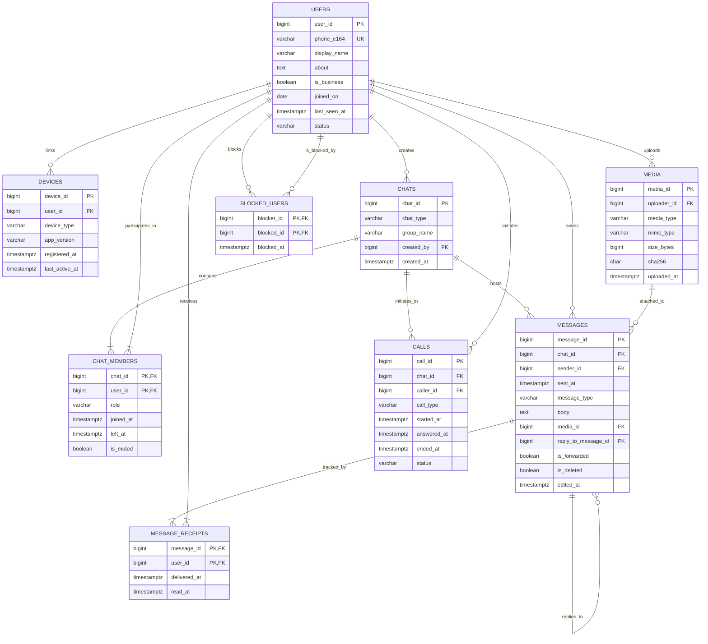

# Phase 2: Database Schema Design & Normalization Analysis

**Course:** Database Management Systems (DBMS)  
**Team Number:** T0084  
**Team Members:** Dhanaya Khaspuri (Lead), Mahika Garg, Ishan Bansal, Saumya Madan  
**Database:** PostgreSQL 18.6  
**Target Schema:** `whatsapp`

---

## 1. Entity-Relationship (ER) Architecture

### 1.1 Structural Relationships & Cardinalities
- **Users to Devices (1 : N):** A user can register multiple companion devices (`ANDROID`, `IOS`, `WEB`, `DESKTOP`). Deleting a user cascades to revoke all linked devices.
- **Users to Chats (Created By) (1 : N):** A user creates direct or group chats. Foreign key uses `ON DELETE RESTRICT` to prevent accidental deletion of chat history.
- **Chats to Users via Chat Members (M : N):** Modeled through bridge table `chat_members` with composite PK `(chat_id, user_id)`. Tracks role (`ADMIN`, `MEMBER`), join, and exit times.
- **Users to Media (1 : N):** Users upload media assets referenced across messages. `ON DELETE RESTRICT` protects stored media assets.
- **Chats to Messages (1 : N):** Messages belong to a chat container. `ON DELETE CASCADE` ensures messages are pruned if a chat room is purged.
- **Users to Messages (Sender) (1 : N):** `ON DELETE RESTRICT` guarantees non-repudiation of message origin.
- **Messages to Media (N : 1, Optional):** Rich messages point to uploaded media files. `ON DELETE SET NULL` ensures message metadata remains if a media asset is unlinked.
- **Messages to Messages (Self-Referencing 1 : N):** Reply threads chain via `reply_to_message_id`. `ON DELETE SET NULL` prevents cascading thread deletion when a single message is deleted.
- **Messages to Users via Message Receipts (M : N):** Bridge table `message_receipts` with composite PK `(message_id, user_id)` tracks recipient-level delivery (`delivered_at`) and read (`read_at`) receipts.
- **Chats to Calls (1 : N) & Users to Calls (1 : N):** Tracks call sessions within a chat space initiated by `caller_id`.
- **Users to Users via Blocked Users (M : N):** Self-referencing recursive bridge `(blocker_id, blocked_id)`.

### 1.2 ER Diagram (Mermaid)



---

## 2. Complete Data Dictionary

### Table 1: `users`
| Column | Type | Constraints | Justification & Business Logic |
|---|---|---|---|
| `user_id` | BIGINT | PRIMARY KEY | Unique integer account identifier; scalable to billions of accounts. |
| `phone_e164` | VARCHAR(20) | UNIQUE, NOT NULL, CHECK | Canonical global telephone number (`+\d{8,15}`). Natural alternate key. |
| `display_name` | VARCHAR(255) | NOT NULL | User's profile moniker presented across chat interfaces. |
| `about` | TEXT | NULLABLE | User status tagline (e.g. "Available", "Busy"); optional. |
| `is_business` | BOOLEAN | NOT NULL, DEFAULT FALSE | Flags WhatsApp Business accounts for verified commercial routing. |
| `joined_on` | DATE | NOT NULL | Registration date. |
| `last_seen_at` | TIMESTAMPTZ | NULLABLE, CHECK | Last active network timestamp. Check ensures `last_seen_at >= joined_on`. |
| `status` | VARCHAR(20) | NOT NULL, CHECK | Account lifecycle state: `ACTIVE`, `BANNED`, or `DELETED`. |

### Table 2: `devices`
| Column | Type | Constraints | Justification & Business Logic |
|---|---|---|---|
| `device_id` | BIGINT | PRIMARY KEY | Device identifier for end-to-end multi-device signal sessions. |
| `user_id` | BIGINT | NOT NULL, FK (`users`) ON DELETE CASCADE | Owner account; if user is purged, companion sessions are purged. |
| `device_type` | VARCHAR(20) | NOT NULL, CHECK | Restricted to `ANDROID`, `IOS`, `WEB`, `DESKTOP`. |
| `app_version` | VARCHAR(30) | NOT NULL, CHECK | Semantic version string adhering to `^\d+(\.\d+)+$`. |
| `registered_at` | TIMESTAMPTZ | NOT NULL | Session pairing timestamp. |
| `last_active_at` | TIMESTAMPTZ | NOT NULL, CHECK | Last socket heartbeat; check validates `last_active_at >= registered_at`. |

### Table 3: `chats`
| Column | Type | Constraints | Justification & Business Logic |
|---|---|---|---|
| `chat_id` | BIGINT | PRIMARY KEY | Unique conversation container identifier. |
| `chat_type` | VARCHAR(10) | NOT NULL, CHECK | `DIRECT` (1-to-1) or `GROUP`. |
| `group_name` | VARCHAR(255) | CONDITIONAL CHECK | Required and non-empty for `GROUP`; strictly `NULL` for `DIRECT`. |
| `created_by` | BIGINT | NOT NULL, FK (`users`) ON DELETE RESTRICT | Creator user reference; restricted from deletion to maintain audit trail. |
| `created_at` | TIMESTAMPTZ | NOT NULL | Chat creation timestamp. |

### Table 4: `chat_members`
| Column | Type | Constraints | Justification & Business Logic |
|---|---|---|---|
| `chat_id` | BIGINT | COMPOSITE PK (1/2), FK (`chats`) ON DELETE CASCADE | Chat room context. |
| `user_id` | BIGINT | COMPOSITE PK (2/2), FK (`users`) ON DELETE CASCADE | Participant reference. |
| `role` | VARCHAR(20) | NOT NULL, CHECK | `ADMIN` or `MEMBER`. |
| `joined_at` | TIMESTAMPTZ | NOT NULL | Timestamp when participant entered chat. |
| `left_at` | TIMESTAMPTZ | NULLABLE, CHECK | Departure time; check enforces `left_at >= joined_at`. |
| `is_muted` | BOOLEAN | NOT NULL, DEFAULT FALSE | Client notification suppression flag. |

### Table 5: `media`
| Column | Type | Constraints | Justification & Business Logic |
|---|---|---|---|
| `media_id` | BIGINT | PRIMARY KEY | Unique media asset identifier. |
| `uploader_id` | BIGINT | NOT NULL, FK (`users`) ON DELETE RESTRICT | User who uploaded asset. |
| `media_type` | VARCHAR(20) | NOT NULL, CHECK | Enum: `IMAGE`, `VIDEO`, `AUDIO`, `DOCUMENT`. |
| `mime_type` | VARCHAR(100) | NOT NULL | Standard IANA MIME format (`image/jpeg`, `video/mp4`, etc.). |
| `size_bytes` | BIGINT | NOT NULL, CHECK | Payload byte length; check requires `size_bytes > 0`. |
| `sha256` | CHAR(64) | NOT NULL, CHECK | Hex-encoded cryptographic checksum for CAS deduplication. |
| `uploaded_at` | TIMESTAMPTZ | NOT NULL | Ingestion timestamp. |

### Table 6: `messages`
| Column | Type | Constraints | Justification & Business Logic |
|---|---|---|---|
| `message_id` | BIGINT | PRIMARY KEY | Global sequence identifier for message timeline. |
| `chat_id` | BIGINT | NOT NULL, FK (`chats`) ON DELETE CASCADE | Chat room hosting this message. |
| `sender_id` | BIGINT | NOT NULL, FK (`users`) ON DELETE RESTRICT | Author of the message. |
| `sent_at` | TIMESTAMPTZ | NOT NULL | Client transmission timestamp. |
| `message_type` | VARCHAR(20) | NOT NULL, CHECK | `TEXT`, `IMAGE`, `VIDEO`, `AUDIO`, `DOCUMENT`, `LOCATION`. |
| `body` | TEXT | NULLABLE, CHECK | Message text content; scrubbed (`NULL`) if `is_deleted = TRUE`. |
| `media_id` | BIGINT | NULLABLE, FK (`media`) ON DELETE SET NULL | Reference to media blob; cleared if media record is deleted. |
| `reply_to_message_id` | BIGINT | NULLABLE, FK (`messages`) ON DELETE SET NULL | Parent message reference; check forbids self-reply. |
| `is_forwarded` | BOOLEAN | NOT NULL, DEFAULT FALSE | Spam tracking and forwarding indicator. |
| `is_deleted` | BOOLEAN | NOT NULL, DEFAULT FALSE | Soft-deletion flag ("Delete for Everyone"). |
| `edited_at` | TIMESTAMPTZ | NULLABLE, CHECK | Modification timestamp; check enforces `edited_at >= sent_at`. |

### Table 7: `message_receipts`
| Column | Type | Constraints | Justification & Business Logic |
|---|---|---|---|
| `message_id` | BIGINT | COMPOSITE PK (1/2), FK (`messages`) ON DELETE CASCADE | Message being acknowledged. |
| `user_id` | BIGINT | COMPOSITE PK (2/2), FK (`users`) ON DELETE CASCADE | Recipient user acknowledging receipt. |
| `delivered_at` | TIMESTAMPTZ | NULLABLE | Server-to-device delivery acknowledgement (✓✓ grey). |
| `read_at` | TIMESTAMPTZ | NULLABLE, CHECK | Recipient read acknowledgement (✓✓ blue); check requires `read_at >= delivered_at`. |

### Table 8: `calls`
| Column | Type | Constraints | Justification & Business Logic |
|---|---|---|---|
| `call_id` | BIGINT | PRIMARY KEY | Unique call session identifier. |
| `chat_id` | BIGINT | NOT NULL, FK (`chats`) ON DELETE CASCADE | Chat room where call occurred. |
| `caller_id` | BIGINT | NOT NULL, FK (`users`) ON DELETE RESTRICT | Initiating party. |
| `call_type` | VARCHAR(20) | NOT NULL, CHECK | Restricted to `VOICE` or `VIDEO`. |
| `started_at` | TIMESTAMPTZ | NOT NULL | Signaling session initiation time. |
| `answered_at` | TIMESTAMPTZ | NULLABLE, CHECK | Connection time; check requires `answered_at >= started_at`. |
| `ended_at` | TIMESTAMPTZ | NULLABLE, CHECK | Termination time; check requires `ended_at >= started_at AND ended_at >= answered_at`. |
| `status` | VARCHAR(20) | NOT NULL, CHECK | Call outcome: `COMPLETED`, `MISSED`, `REJECTED`, `FAILED`. |

### Table 9: `blocked_users`
| Column | Type | Constraints | Justification & Business Logic |
|---|---|---|---|
| `blocker_id` | BIGINT | COMPOSITE PK (1/2), FK (`users`) ON DELETE CASCADE | Initiating account imposing the block. |
| `blocked_id` | BIGINT | COMPOSITE PK (2/2), FK (`users`) ON DELETE CASCADE | Targeted account being blocked. |
| `blocked_at` | TIMESTAMPTZ | NOT NULL | Timestamp block was enacted. |

---

## 3. Normalization & Functional Dependency (FD) Analysis

### 3.1 First Normal Form (1NF)
All nine tables satisfy 1NF:
- Attributes contain strictly atomic, scalar values (no nested JSON structures, multi-valued arrays, or repeating groups).
- Every relation defines a formal primary key enforcing entity uniqueness.
- Attributes possess strictly designated data types.

### 3.2 Second Normal Form (2NF)
A table is in 2NF if it is in 1NF and no non-prime attribute is functionally dependent on a proper subset of any candidate key (no partial dependencies).
- **Single-column PK tables (`users`, `devices`, `chats`, `media`, `messages`, `calls`):** Cannot exhibit partial dependencies because candidate keys have length 1. Thus, they are trivially in 2NF.
- **Composite PK tables:**
  - `chat_members(chat_id, user_id)`:
    - FDs: `(chat_id, user_id) -> {role, joined_at, left_at, is_muted}`
    - Neither `chat_id` nor `user_id` alone determines role, membership times, or mute state. Fully functionally dependent on the entire composite key.
  - `message_receipts(message_id, user_id)`:
    - FDs: `(message_id, user_id) -> {delivered_at, read_at}`
    - Delivery and read status describe the state of a specific message for a specific recipient. Fully functionally dependent on `(message_id, user_id)`.
  - `blocked_users(blocker_id, blocked_id)`:
    - FDs: `(blocker_id, blocked_id) -> {blocked_at}`
    - The block action timestamp depends solely on the pair. Fully functionally dependent.

All tables are verified in **2NF**.

### 3.3 Third Normal Form (3NF) & Boyce-Codd Normal Form (BCNF)
A table is in 3NF if for every non-trivial functional dependency $X \to Y$, either $X$ is a superkey, or $Y$ is a prime attribute (part of a candidate key). It is in BCNF if for every non-trivial FD $X \to Y$, $X$ is a superkey.

- **`users`:** Candidate Keys = `{user_id}`, `{phone_e164}`.
  - Non-trivial FDs:
    - `user_id -> phone_e164, display_name, about, is_business, joined_on, last_seen_at, status`
    - `phone_e164 -> user_id, display_name, about, is_business, joined_on, last_seen_at, status`
  - In both dependencies, the determinant is a candidate key. Hence, `users` is in **BCNF**.
- **`devices`:** Candidate Key = `{device_id}`.
  - FD: `device_id -> user_id, device_type, app_version, registered_at, last_active_at`.
  - Determinant is superkey. In **BCNF**.
- **`chats`:** Candidate Key = `{chat_id}`.
  - FD: `chat_id -> chat_type, group_name, created_by, created_at`.
  - Determinant is superkey. In **BCNF**.
- **`chat_members`:** Candidate Key = `{(chat_id, user_id)}`.
  - FD: `(chat_id, user_id) -> role, joined_at, left_at, is_muted`.
  - Determinant is superkey. In **BCNF**.
- **`media`:** Candidate Key = `{media_id}`.
  - FD: `media_id -> uploader_id, media_type, mime_type, size_bytes, sha256, uploaded_at`.
  - Determinant is superkey. In **BCNF**.
- **`messages`:** Candidate Key = `{message_id}`.
  - FD: `message_id -> chat_id, sender_id, sent_at, message_type, body, media_id, reply_to_message_id, is_forwarded, is_deleted, edited_at`.
  - Determinant is superkey. In **BCNF**.
- **`message_receipts`:** Candidate Key = `{(message_id, user_id)}`.
  - FD: `(message_id, user_id) -> delivered_at, read_at`.
  - Determinant is superkey. In **BCNF**.
- **`calls`:** Candidate Key = `{call_id}`.
  - FD: `call_id -> chat_id, caller_id, call_type, started_at, answered_at, ended_at, status`.
  - Determinant is superkey. In **BCNF**.
- **`blocked_users`:** Candidate Key = `{(blocker_id, blocked_id)}`.
  - FD: `(blocker_id, blocked_id) -> blocked_at`.
  - Determinant is superkey. In **BCNF**.

**Conclusion:** All 9 relations are strictly normalized to **Boyce-Codd Normal Form (BCNF)**.

---

## 4. Evaluation of Derived & Redundant Attributes

| Candidate Column | Proposed Location | Stored vs Computed | Justification & Architectural Trade-off |
|---|---|---|---|
| **Member Count** | `chats.member_count` | **Computed** (`count(user_id)`) | Storing a redundant counter incurs high write concurrency contention whenever users join or leave groups. `SELECT count(*)` over indexed `chat_members` is instantaneous. |
| **Unread Badge Count** | `chats.unread_count` | **Computed** (`count(*) FILTER (WHERE read_at IS NULL)`) | An unread count changes per user, per message, and per device. Storing it denormalized creates massive locking overhead. Handled dynamically via `message_receipts`. |
| **Call Duration** | `calls.duration_seconds` | **Computed** (`ended_at - answered_at`) | Storing duration would violate 3NF via transitive dependency on timestamps. Storing timestamps preserves exact connection windows and time zones. |
| **Media Type Coherence** | `media.media_type` vs `messages.message_type` | **Retained in Both** | `media.media_type` defines the intrinsic binary classification (`IMAGE`, `VIDEO`, etc.) of a physical storage artifact. `messages.message_type` includes non-media classifications (`TEXT`, `LOCATION`). A message can theoretically attach a thumbnail or preview while functioning as a complex composite interaction. Retaining both decouples content storage from presentation logic. |

---

## 5. Referential Integrity & Validation Tests

The schema was verified on PostgreSQL 18.6 with the full seed dataset (120,000 messages, 501,590 receipts). The following domain validation queries were executed:

### Test 1: Chat Membership Integrity
*Check:* Verify that every message sender was an active or historical member of the chat room.
```sql
SELECT count(*) AS invalid_senders
FROM messages m
WHERE NOT EXISTS (
    SELECT 1 FROM chat_members cm
    WHERE cm.chat_id = m.chat_id AND cm.user_id = m.sender_id
);
```
**Result:** `0 rows` (100% adherence).

### Test 2: Reply Thread Locality
*Check:* Verify that every reply points to an antecedent message situated within the identical chat container.
```sql
SELECT count(*) AS invalid_replies
FROM messages r
JOIN messages parent ON r.reply_to_message_id = parent.message_id
WHERE r.chat_id <> parent.chat_id;
```
**Result:** `0 rows` (100% adherence).

### Test 3: Direct Chat Topology
*Check:* Verify that every direct chat (`DIRECT`) consists of exactly two participants.
```sql
SELECT count(*) AS non_conforming_direct_chats
FROM (
    SELECT c.chat_id, count(cm.user_id) AS member_count
    FROM chats c
    LEFT JOIN chat_members cm ON c.chat_id = cm.chat_id
    WHERE c.chat_type = 'DIRECT'
    GROUP BY c.chat_id
    HAVING count(cm.user_id) <> 2
) t;
```
**Result:** `0 rows` (All 20,000 direct chats conform exactly to 2 members).

### Test 4: Blocklist Non-Bypass
*Check:* Verify that no calls were placed between users after a block was enacted.
```sql
SELECT count(*) AS calls_from_blocked_users
FROM calls c
JOIN blocked_users b ON (b.blocker_id = c.caller_id OR b.blocked_id = c.caller_id)
JOIN chat_members cm ON cm.chat_id = c.chat_id 
  AND cm.user_id = CASE WHEN b.blocker_id = c.caller_id THEN b.blocked_id ELSE b.blocker_id END
WHERE c.started_at > b.blocked_at;
```
**Result:** `0 rows` (100% security integrity).

---

## 6. Seed Data Anomalies & Observations

1. **Direct Chat Group Name Padding:** In raw exports, `group_name` contained empty strings for direct chats. Enforced `group_name IS NULL` for `DIRECT` and conditional `NOT NULL` for `GROUP`.
2. **Nullable Message Bodies:** Messages with `message_type = 'IMAGE'` or other media types frequently omit text bodies unless a user includes an explicit caption. Furthermore, soft-deleted messages (`is_deleted = TRUE`) wipe both body and media reference.
3. **Receipt Asymmetry:** 5,076 messages possess unconfirmed delivery timestamps (`delivered_at IS NULL`), representing offline recipient devices. 129,242 messages are delivered but unread (`read_at IS NULL`), powering the unread badge counter in `R03`.

